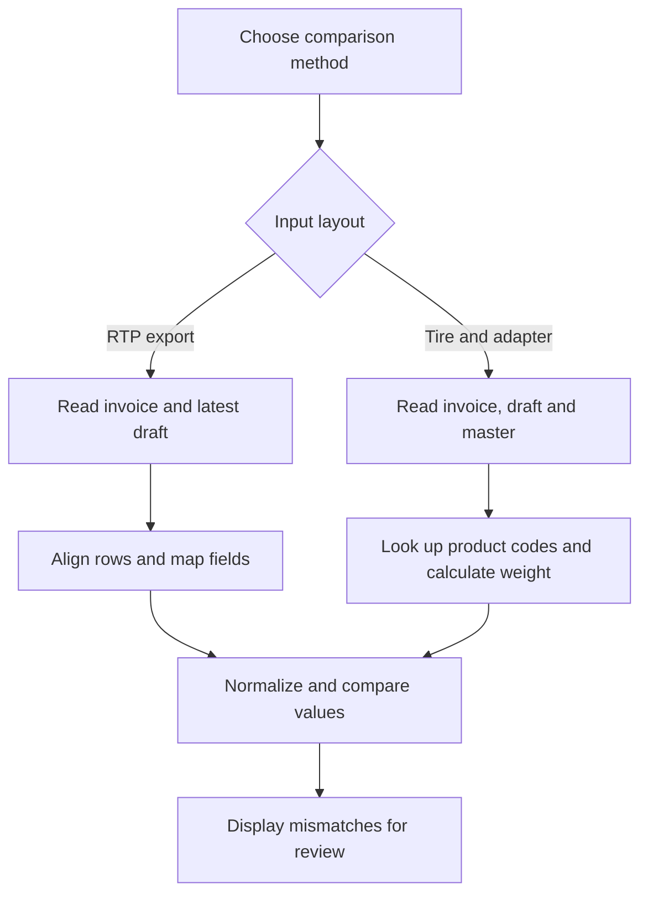

# Returnable Packaging Export Draft Checker

Python notebook for reviewing draft export customs declarations for returnable packaging against invoice data and product master records. The operational scope covers **สิทธิอนุมัติหลักการ** (approval-in-principle workflow) and **สุทธินำกลับ** (re-importation certificate workflow). These English labels describe the workflows; they are not verified official translations.

This project supports an operator's document review before submission. It does not submit declarations or connect to SAP or a customs system.

## Operational impact

Based on the operator's reported average of **20 invoices per month**, this tool saves approximately **80 minutes per month**, equivalent to **4 minutes per invoice**. These figures describe the observed workflow improvement, rather than a controlled performance benchmark.

## Implemented checks

The source notebook contains two comparison methods. It does not explicitly label which customs workflow each method belongs to; select the method according to the source document layout and confirm the relevant customs treatment separately.

| Method | Input | Matching |
| --- | --- | --- |
| RTP invoice comparison | UTF-16 delimited invoice export named `Invoice Excel.xls`, plus a draft `.xlsx` | Row by row in the same order |
| Returnable tire and adapter comparison | Invoice `.xlsx` with an `INVOICE` worksheet, draft `.xlsx`, and embedded product master | Draft product code against invoice model number and master part number |

The RTP method checks invoice number, product code, brand, descriptions, tariff code, privilege, quantity, unit, weight, unit price, currency, vessel, origin, and approval reference. Its current weight mapping compares draft net weight to the invoice field `Total G.W.(Kgs)`; confirm this mapping for your actual template.

The tire/adapter method checks invoice number, product code, brand, descriptions, tariff code, quantity, unit price, unit, currency and country, and calculates expected net weight as **master unit net weight × invoice quantity**, rounded to one decimal. Its current country mapping compares draft destination country to master `Origin Country`; confirm that this is appropriate for your shipment. It does not explicitly validate a re-importation certificate number.

## Python logic



Normalization removes spaces, ignores letter case and converts numeric-looking values to float strings. `PC` and `C62` are treated as equivalent units. The RTP method also rounds predominantly numeric invoice columns to one decimal.

## Run locally

The source notebook and embedded product master are private and are not published in this repository. The instructions below describe the owner's local workflow.

1. Install Python and dependencies: `pip install -r requirements.txt`.
2. Start Jupyter: `jupyter notebook`.
3. Open the private source notebook.
4. Edit `file_path_inv`, `file_path_draft` and/or `folder` in the chosen comparison cell. Example paths point to `data/`.
5. Confirm source headers, column positions and master values against your actual templates.
6. Run only the selected comparison section. The original final RTP cell duplicated the earlier RTP cell and was removed from this publication copy.

The RTP reader expects metadata on row 9 and headers on row 13. Despite its `.xls` suffix, its invoice input is delimited text, not a binary Excel workbook. The tire/adapter reader expects invoice number in row 4, column AI, item data from row 32, and model descriptions on the next row.

## Output

Notebook output includes mismatch tables, success messages and, for the RTP method, row-count warnings and elapsed time. No real shipment output is included. A mismatch table contains the row or part number, field, draft value, reference value and status.

## Example output

The examples below use **entirely fictional data**. They illustrate the notebook's output format and are not screenshots or results from real shipments. The elapsed times are illustrative.

### Example 1: All compared fields match

Assume both documents contain the same number of rows, every required field is present, and all compared values match after normalization.

```text
✅ ข้อมูลทุก field ตรงกันหมด!

⏱️ ใช้เวลา run ทั้งหมด: 0m 0.85s
```

No mismatch table is displayed. For example, a draft unit of `C62` and an invoice unit of `PC` are treated as a match.

### Example 2: Some fields do not match

```text
⚠️ พบข้อมูลไม่ตรงกัน 3 รายการ
```

| Row | Field | df_draft | df_inv | Status |
| --- | --- | --- | --- | --- |
| 1 | ปริมาณ (Invoice) | 18 | 20 | ⚠️ ไม่ตรง |
| 1 | Unit price (เงินต่างประเทศ) | 110 | 100 | ⚠️ ไม่ตรง |
| 2 | เลขที่อินวอยซ์ | DEMO-INV-002 | DEMO-INV-001 | ⚠️ ไม่ตรง |

```text
⏱️ ใช้เวลา run ทั้งหมด: 0m 0.92s
```

Only mismatching fields are displayed; matching fields are omitted. The operator reviews the highlighted differences against the source documents before making corrections.

**Interpretation:** An all-fields-match message covers the comparisons performed by the current logic. Missing fields, unmatched product codes and extra rows still require the separate checks described below.

## Limitations of the original logic

- Fixed templates, headers, column positions and embedded master records require maintenance.
- RTP uses row order, compares only the shorter row count and selects the most recently modified `.xlsx` in the configured folder. Extra rows are warned about but not compared; unrelated workbooks can be selected.
- Tire/adapter matching assumes unique product codes. Repeated codes require additional handling. Invoice/master records absent from the draft are not checked.
- Missing columns can become empty values and appear equal. Numeric normalization can discard leading zeros and precision.
- Tire/adapter missing-master and missing-invoice statuses are recorded in `df_result` but excluded from the displayed mismatch table. Empty values receive an information status. Consequently, an all-fields-match message is not proof that every item was validated; inspect `df_result` too.
- This notebook checks selected data fields. It does not verify legal eligibility, approval validity, certificate requirements or the complete correctness of either customs treatment.
- The source notebook and embedded product master remain private. This repository documents the workflow and uses fictional output examples.

## Repository contents

| File | Purpose |
| --- | --- |
| `requirements.txt` | Notebook and comparison dependencies |
| `.gitignore` | Excludes local shipment data and notebook checkpoints |

Real invoice and declaration files are not included. Runtime comparison against actual workbooks has not been performed; publication checks cover notebook structure and Python syntax.
